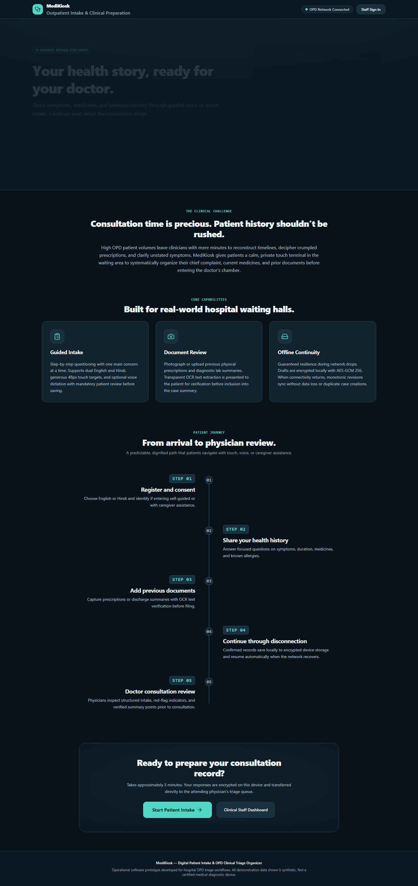
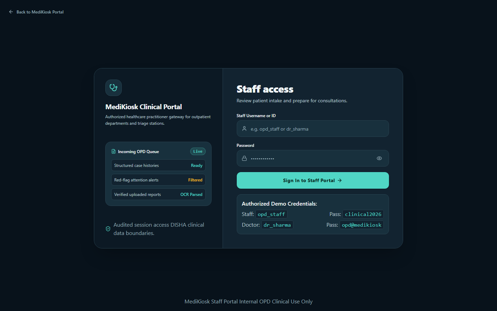
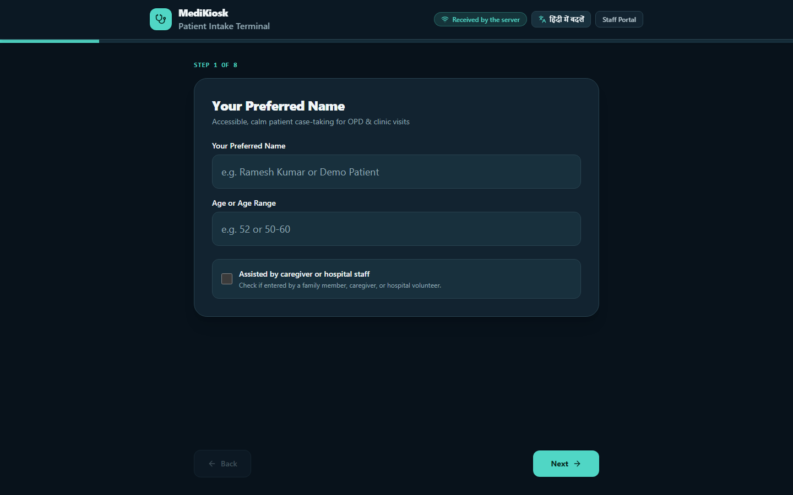
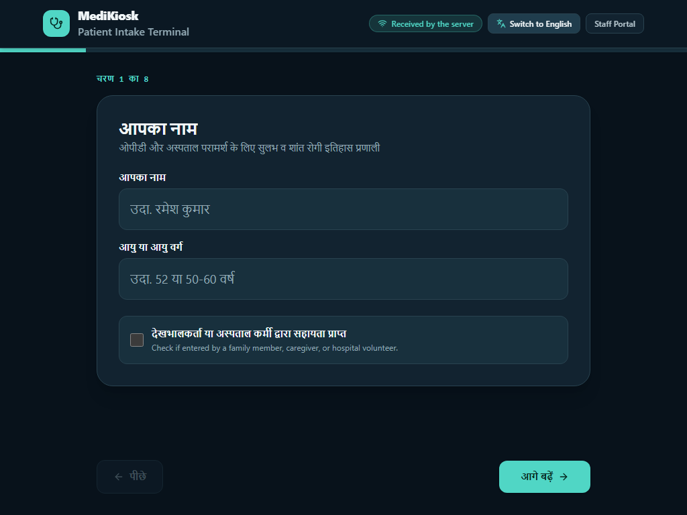
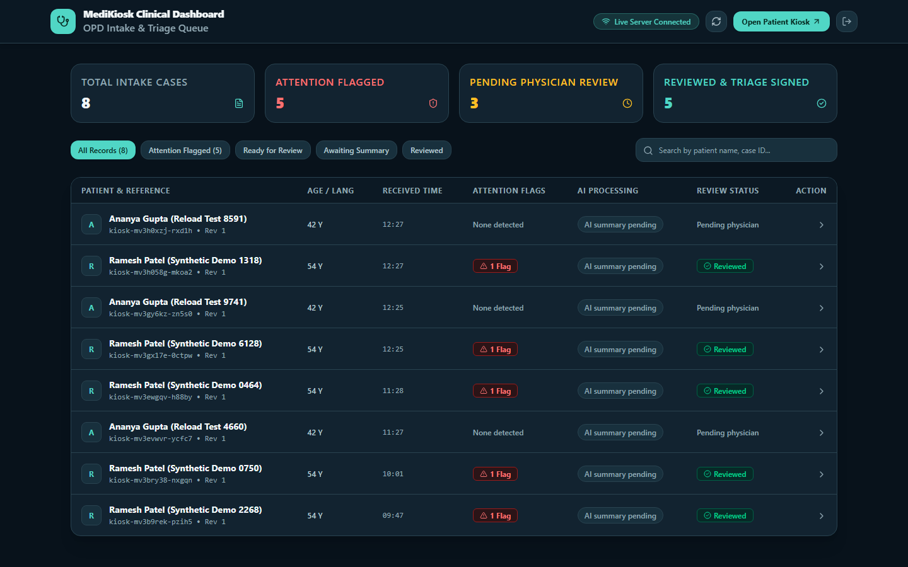

# MediKiosk — Accessible Clinical Outpatient Intake

> **Dark Healthcare Redesign:** Polished, visually distinctive dark healthcare interface built for outpatient department (OPD) triage, walk-up kiosk accessibility, and intermittent network resilience.

---

## 1. Executive Summary & Clinical Context

In overburdened outpatient departments (OPDs), consultation time is severely constrained. Patients frequently arrive with unstructured paper records, anxiety, and fragmented symptoms.

**MediKiosk** provides a calm, dignified digital intake terminal in the OPD waiting area:
- **For Patients:** Guided, step-by-step touch and voice intake in **English and Hindi** with large (48px+) touch controls, clear "Unknown" vs "None reported" options, and document capture.
- **For Clinicians:** Structured summaries with separated red-flag triage alerts, verified OCR document excerpts, and clear provenance.
- **For Hospital Infrastructure:** Uncompromising offline continuity that tolerates severe network cuts (>30s) and browser restarts without data loss or duplicate case creation.

---

## 2. Dark Healthcare Design System

The application strictly implements a calm, high-contrast **Dark Healthcare Design System**:

| Token Name | Hex Value | Application & Usage |
| :--- | :--- | :--- |
| **Main Background** | `#08121B` | Primary page & terminal backdrop |
| **Section Background** | `#0C1924` | Hero section, header bar, navigation rails |
| **Card Surface** | `#122330` | Kiosk step container, dashboard queue table, review modal |
| **Elevated Surface** | `#18303D` | Form inputs, buttons, document tray cards, milestone markers |
| **Borders** | `#294350` | Thin, deliberate borders across inputs, cards, and tables |
| **Primary Text** | `#F1F6F8` | High-contrast headings, active labels, primary values |
| **Secondary Text** | `#B6C7CF` | Comfortable body text, card descriptions, table cells |
| **Muted Text** | `#91A8B3` | Timestamps, metadata labels, helper guidance |
| **Primary Teal** | `#50D6C5` | Interactive brand accent, timeline progress line, active badges |
| **Primary Button Text**| `#062820` | Deep contrast text on primary teal buttons |
| **Focus Indicator** | `#7DD3FC` | Accessible 2px outline for keyboard navigation (`:focus-visible`) |
| **Caution Amber** | `#FBBF24` on `#261B0E` | Amber border `#854D0E` for offline notices & unconfirmed voice |
| **Attention Coral/Red**| `#F87171` on `#2B1417` | Red border `#991B1B` for clinical triage red flags & errors |

### Accessibility & Interaction Standards
- **Touch Target Sizing:** All interactive kiosk controls, inputs, and buttons are at least **48px tall** (`min-h-[48px]`).
- **Devanagari / Hindi Support:** High-legibility typography rendered using `Noto Sans Devanagari` and `Mangal` fallbacks with full UTF-8 character integrity.
- **Distinguishable States:** Selected options are differentiated by border thickness, background tint, explicit checkmark icon, and font weight—not color alone.
- **Print Optimization:** Printable intake reports automatically render with a **pure white background and dark text** (`@media print`) so physical printing remains clear and ink-efficient.
- **Autofill & Theme Flashes:** Input autofill overrides maintain dark palette; reduced motion preferences are respected across all animated elements.

---

## 3. Screen-by-Screen Interface Architecture

### Landing Page Portal (`/`)
- **Two-Column Hero:**
  - **Left:** Small label *"Patient intake for OPDs"*, headline *"Your health story, ready for your doctor."*, concise description, and direct actions *"Start patient intake"* (`/kiosk`) and *"Staff sign in"* (`/login`).
  - **Right:** Dimensional medical record illustration labeled *"Illustrative example"* with synthetic data, backed by a subtle, contained teal/silver liquid metal visual (`opacity-20`). The shader is lazy-loaded, suspended offscreen via `IntersectionObserver`, and bypassed under `prefers-reduced-motion`.
- **Problem Statement:** Concise explanation of high OPD volume challenges and why structured patient history collection improves consultation efficiency.
- **Three Capability Panels:**
  1. *Guided intake* (bilingual, 48px controls, voice confirmation).
  2. *Document review* (physical prescription OCR with mandatory verification).
  3. *Offline continuity* (AES-GCM encryption, monotonic revisions, zero duplicates).
- **Patient Journey Timeline:** Restyled in dark teal with interactive progress indicator.
- **Final Action:** Prominent intake trigger card.

### Patient Intake Kiosk (`/kiosk`)
- **One Question Per Step:** Focused step flow with visible progress bar.
- **Live Status Header:** Shows real operational state:
  - *"Saved on this device"*
  - *"Offline — you can continue"*
  - *"Waiting to synchronise"*
  - *"Received by the server"*
  - *"AI summary pending"*
  - *"Ready for staff review"*
- **Language Switcher:** Instant English / Hindi toggle preserving active answers.
- **Steps:**
  1. Registration (self vs assisted entry).
  2. Plain-language patient consent.
  3. Chief concern (touch or voice dictation with local verification box).
  4. Symptoms checklist (large 52px buttons with icons and Hindi labels).
  5. Past conditions & current medicines (explicit "None reported" and "Unknown").
  6. Allergies (explicit "None reported", "Unknown", or "Reported" details).
  7. Document capture & OCR verification (prescriptions, discharge slips).
  8. Final review & submission.
- **Completion & Reset:** Displays reference ID, sync state, and a *"Finish & Prepare for Next Patient"* action that securely purges in-memory keys for patient privacy.

### Staff Portal & Authentication (`/login`)
- Clean, dark opaque form surfaces with clear labels.
- Password visibility toggle (`Eye` / `EyeOff`).
- Connected directly to `/api/auth` with genuine error reporting and loading spinners.
- Removed all astronaut, space, and simulated-success content.

### Clinical Dashboard & Triage Workspace (`/dashboard`)
- Compact navigation rail with real-time network and freshness indicators.
- **Genuine Metric Cards:** Calculated strictly from loaded database records (Total cases, Attention flagged, Pending review, Reviewed). Zero fabricated vital signs.
- **Searchable Case Queue:** Search by patient name or reference ID; filter by Flagged, Ready, Awaiting Summary, and Reviewed.
- **Case Detail Modal:** Complete structured intake breakdown, OCR document source verification, AI clinical synthesis, and staff triage sign-off notes.

---

## 4. Operational Status Indicators

All operational states reflect genuine underlying system state:

- **"Saved on this device"** — Active draft written to local encrypted IndexedDB.
- **"Offline — you can continue"** — Terminal is operating offline; intake continues without obstruction.
- **"Waiting to synchronise"** — Queued records waiting for server acknowledgment.
- **"Received by the server"** — Server has confirmed intake receipt with monotonic revision verification.
- **"AI summary pending"** — Case synced; AI synthesis pending external provider response or credentials.
- **"Ready for staff review"** — Structured synthesis ready for physician consultation.

---

## 5. Visual Proof & Screenshots

All screenshots captured from the running local application with synthetic data:

### Landing Page Portal (Hero & Journey)


### Professional Staff Login


### Patient Intake Kiosk (Step-by-Step Flow & Hindi Support)



### Clinical OPD Queue Dashboard & Case Detail


---

## 6. Challenge Card 1: Offline Disconnection & Resilience

### Verification Matrix

| Requirement | Verification Level | Measured Outcome |
| :--- | :--- | :--- |
| **Offline Data Caching** | **Browser-Tested & Unit-Tested** | **VERIFIED:** Dexie IndexedDB + Service Worker precache. Handled a genuine 31.0s network cut mid-intake (`context.setOffline(true)`). |
| **Encryption at Rest** | **Browser-Tested & Unit-Tested** | **VERIFIED:** Dual-layer Web Crypto (AES-GCM 256). Active drafts encrypted via `SessionKey`; `pendingSyncQueue` and `mediaBlobs` encrypted via `DeviceQueueKey`. Zero plaintext at rest. |
| **Offline Reload Recovery** | **Browser-Tested** | **VERIFIED:** Proved via `tests/e2e/reload-recovery.spec.ts`. Genuinely reloaded browser (`page.reload()`) offline, tearing down JavaScript memory; recovered draft from ciphertext via `sessionStorage` session key re-import. |
| **Next-Patient Privacy** | **Browser-Tested** | **VERIFIED:** Reset wipes active `SessionKey` and draft from UI. Background encrypted queue remains intact and drains cleanly upon reconnect. |
| **Idempotency & Zero Duplicates** | **Browser-Tested & Unit-Tested** | **VERIFIED:** Monotonic revisions with idempotency keys. SQLite asserts `recordCount: 1` and `duplicateCount: 0`. |
| **Data Freshness & Retention** | **Unit-Tested** | **VERIFIED:** 30-min reconfirmation window and 24-hr cache expiry policies verified in `tests/freshness.test.ts`. |
| **Reconnect Latency** | **Browser-Tested** | **VERIFIED:** `reconnectToSyncAcknowledgmentMs: 3.03s` (target < 5s). `reconnectToStructuredIntakeReadyMs: 3.53s`. |

---

## 7. Verification & Test Suite Execution

### Unit & Integration Tests (13/13 Passed)
```bash
npm test
```
- `tests/rules.test.ts` (4 tests) — Deterministic red-flag triggers
- `tests/repository.test.ts` (5 tests) — SQLite repository & monotonic revision deduplication
- `tests/freshness.test.ts` (3 tests) — 30-minute staleness reconfirmation policies
- `tests/summarizer.test.ts` (1 test) — AI adapter schema validation

### End-to-End Tests (2/2 Passed)
```bash
npx playwright test
```
- `tests/e2e/disconnection.spec.ts` — 30+ second offline disconnection tolerance mid-intake
- `tests/e2e/reload-recovery.spec.ts` — Genuine offline browser reload recovery & next-patient privacy wipe

### Type Check & Production Build
```bash
npx tsc --noEmit     # 0 errors
npm run build        # Production build successful with Turbopack
```

---

## 8. Local Setup & Execution

### Prerequisites
- Node.js 18+ (tested on Node v22)
- npm

### Installation & Run
```bash
cd medikiosk-aftercode
npm install --legacy-peer-deps
npm run build
npm run start
```
Open [http://localhost:3000](http://localhost:3000) in your browser.

**Staff Login Demo Credentials:**
- Staff: `opd_staff` / Password: `clinical2026`
- Doctor: `dr_sharma` / Password: `opd@medikiosk`

---

## 9. AI Verification Status & Known Limitations

- **AI Verification Status:** AI provider integration supports real external LLM keys via `AI_PROVIDER` and `AI_API_KEY` environment variables. When unconfigured, the system honestly labels the summary as *"Local Heuristic Pipeline (Fallback)"* or *"AI summary pending"*. Real AI live provider verification remains pending until external API keys are provisioned in the deployment environment.
- **Live Deployment:** Marked as **Pending**. All local development, tests, production build, and GitHub repository publication are completed.
- **Voice Dictation:** Uses the browser Web Speech API when online/supported. When offline, voice can be recorded and queued for deferred server transcription.
