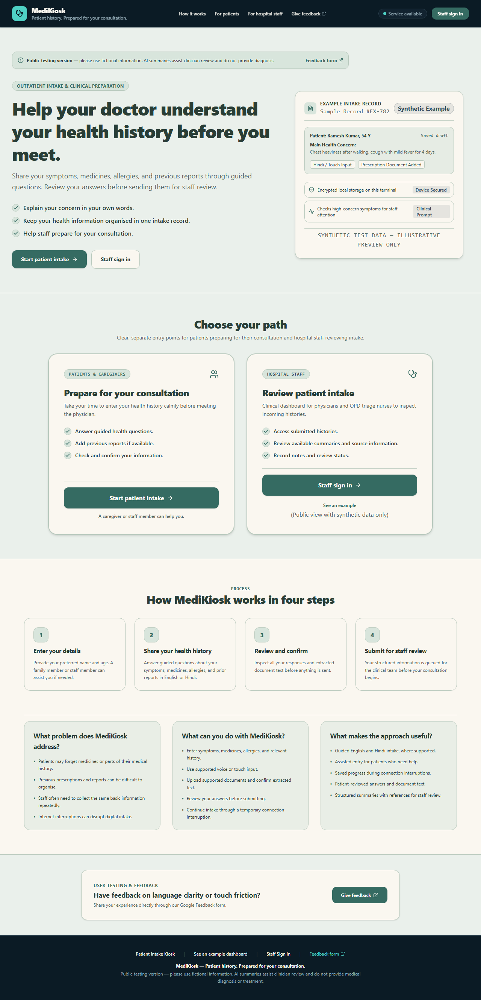
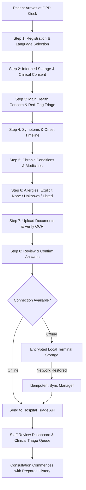

# MediKiosk - Outpatient Digital Intake & Clinical Triage Terminal

> **Live Production Website**: [https://medikiosk-aftercode.vercel.app/](https://medikiosk-aftercode.vercel.app/)  
> **Public GitHub Repository**: [https://github.com/swatijain200701-sys/medikiosk-aftercode](https://github.com/swatijain200701-sys/medikiosk-aftercode)  
> **Sole Participant**: Swati Jain  
> **Challenge Evolution**: Phase 1 (Build) → Challenge Card 1 / Phase 2 (Offline Adaptation) → Challenge Card 2 / Phase 3 (Real-World Feedback & Improvements)

---

## 1. Project Overview & Clinical Context

In overburdened hospital outpatient departments (OPDs), consultation time is constrained. Patients frequently arrive with unstructured paper records, anxiety, and fragmented recall of past medications, while hospital clinical teams are forced to spend valuable consultation minutes re-collecting repetitive demographic and intake data.

**MediKiosk** is a resilient, walk-up digital intake kiosk and clinical triage assistant. It empowers patients and their caregivers to record structured symptoms, medications, allergies, and prior reports before their consultation begins—functioning seamlessly through hospital network interruptions and organizing the intake into a structured record for hospital clinical staff.



### The Core Problem
- **Fragmented Medical Recall**: Patients frequently forget medication dosages, allergy details, or symptom onset timelines under waiting-room stress.
- **Physical Document Management**: Previous prescriptions and laboratory reports are easily misplaced or difficult for clinicians to rapidly parse.
- **Repetitive Intake Burden**: Clinical staff must manually re-interview each patient for foundational history, cutting short actual diagnostic time.
- **Network Vulnerability in Clinics**: Hospital Wi-Fi and mobile connectivity frequently drop; traditional web forms lose patient progress when disconnected.

### Intended Users
1. **Patients & Caregivers**: Individuals waiting in outpatient reception who need guided, dignified, multi-modal intake (touch, voice dictation, English/Hindi).
2. **Hospital Clinical Staff (Doctors, Triage Nurses, OPD Administrators)**: Medical teams who need structured case timelines, red-flag triage highlights, and rapid review tools before seeing the patient.

---

## 2. Complete User Journey & System Architecture



### End-to-End User Journey
1. **Walk-Up Reception**: The patient approaches the terminal and chooses English or Hindi.
2. **Informed Consent**: Explicit consent checkboxes are unchecked by default; storage consent is mandatory to proceed.
3. **Structured Intake**: The patient records their primary concern (with real-time red-flag detection for critical symptoms like chest pain or shortness of breath), symptoms, medicines, and allergies.
4. **Document Support**: Prior documents can be captured, with extracted text presented to the patient for review.
5. **Review & Confirm**: The patient inspects all answers before confirming submission.
6. **Offline Resilience**: If the hospital network is down, the intake is encrypted locally and queued. The kiosk clearly shows *"Saved on this device. Waiting to send."* until the network confirms receipt with *"Received by the server"*.
7. **Kiosk Session Reset**: When the session finishes, all local clinical draft state and theme preferences are wiped, restoring the terminal to a fresh Light mode for the next patient.
8. **Staff Review**: Authenticated clinical staff view structured intake cases on the triage dashboard before calling the patient.

---

## 3. Evolution Through Both Challenge Cards

### Phase 1: Build (Core Application)
- Built the foundational dual-language patient intake workflow with multi-step progression.
- Implemented touch and speech recognition inputs, document OCR text extraction, and staff dashboard case listing.

### Challenge Card 1 / Phase 2: Offline Adaptation & Resilience
In response to Challenge Card 1, MediKiosk was architected for intermittent and disconnected environments:
- **AES-GCM Local Storage Encryption**: Queued records in terminal storage are encrypted before persistence to prevent plain-text exposure on shared hardware.
- **Idempotent Synchronization**: Each submission generates a UUID-based idempotency key. Network retries will never produce duplicate triage entries.
- **Deterministic Revision Ordering**: State modifications track logical monotonic revisions, preventing stale overwrites when replaying delayed network queues.
- **Status Decoupling**: Explicit separation of states:
  - *Local Save*: Instant (`<10ms`), confirmed immediately on terminal memory.
  - *Server Acknowledgment*: Handshake confirmed over HTTP 200.
  - *AI Summary Status*: Separated from raw sync latency. Deterministic local template fallbacks are used when remote AI inference is pending or unverified.
- **Reload Recovery**: Terminal page refreshes safely restore active intake drafts from encrypted session memory.
- **Automatic Session Reset**: Completing an intake purges patient data from the terminal to safeguard privacy.

*Detailed measured outcomes are documented in [`docs/OFFLINE_TEST_REPORT.md`](docs/OFFLINE_TEST_REPORT.md).*

### Challenge Card 2 / Phase 3: Real-World Feedback & Improvements
In response to Challenge Card 2, the prototype was shared with community members and peers (`n=16` responses collected via Google Forms):
- **Working Light / Dark / System Theme Toggle**:
  - Addressed direct feedback (*"Background, and dark theme"*, *"Colour pallet"*, *"can work on the colours"*).
  - Architected a theme system with exact semantic tokens: Light mode (Sage Mist `#EAF0EB`, Warm Cream `#FAF7F0`, Soft Sage `#D8E5DC`, Teal `#356B62`) and Dark mode (`#0B151C`, `#0E1D26`, `#152832`, `#EDF4F2`, `#B5C7C5`, `#36505A`, `#59C7B6`, `#8AC7FF`).
  - Default Light on fresh visit; anti-flash inline script preventing hydration flicker; automatic reset to Light on kiosk completion.
- **Consent Integrity**: Unchecked consent checkboxes by default; disabled "Next" until storage consent is confirmed.
- **Allergy Clarity**: Enforced explicit options (*No known allergies*, *Unknown*, *Has allergies*) rather than assuming absence.
- **Incomplete Intake Validation**: Blocked submission of empty/partial records without health details.
- **Attention Trigger Keyword Expansion**: Updated `lib/rules/red-flags.ts` keyword matching to trigger on both shortness of breath and chest pain variations.
- **Server-Side Staff Access Protection**: Authenticated session cookies guarding `/dashboard` and `/api/cases`.
- **Restored Journey Timeline**: Re-integrated the interactive step-by-step patient journey timeline (`ScrollTimeline`) with reduced-motion support.

*Detailed quantitative charts, participant quotes, and resolution tables are documented in [`feedback/README.md`](feedback/README.md).*

---

## 4. Technologies & AI Tools Used

| Layer | Technologies & Tools | Purpose |
| :--- | :--- | :--- |
| **Framework** | Next.js 16 (Turbopack, App Router) | Fast React server components and client interactions |
| **Language & Typing** | TypeScript 5 | Strict end-to-end type safety |
| **Styling** | Tailwind CSS + CSS Semantic Variables | Dual-theme design system with accessible contrast |
| **Icons** | Lucide React | Healthcare and interface iconography |
| **Local Database** | LibSQL / SQLite (`better-sqlite3` + `@libsql/client`) | Offline-capable local database with Turso cloud capability |
| **Client Storage** | IndexedDB / localStorage + Web Crypto API (AES-GCM) | Encrypted client-side queue for offline resilience |
| **Audio & Speech** | Web Speech API | Dual-language voice dictation assistance |
| **Testing** | Vitest (Unit & Regression), Playwright (E2E) | Automated test suite verifying rules and feedback fixes |
| **AI Tools** | Google Gemini (coding assistant), Tesseract OCR | Code generation pair-programming and client OCR parsing |

### Transparency on AI & Third-Party Integrations
- **AI Summary**: MediKiosk includes an AI summarization pipeline adapter in `src/lib/ai/summarizer.ts`. When remote LLM inference is not connected, it executes a deterministic clinical template summary. *We do not misrepresent template outputs as live AI inference.*
- **ABHA Identity**: MediKiosk provides a prototype verification flow for India's Ayushman Bharat Health Account (ABHA). Live production uses mock sandbox verification pending official ABDM gateway credentials.

---

## 5. Implementation Status: Working vs. Planned

| Feature | Status | Notes |
| :--- | :--- | :--- |
| **8-Step Patient Intake** | **Working** | Full progression with English and Hindi dual-language support |
| **Offline Encryption & Queue** | **Working** | Tested under simulated network drops; idempotent background sync |
| **Light / Dark / System Theme** | **Working** | Working header toggle, zero-flicker init script, default Light, kiosk reset |
| **Red-Flag Clinical Alerts** | **Working** | Chest pain, shortness of breath, and faintness keyword triggers |
| **Informed Consent Enforcement** | **Working** | Mandatory unchecked-by-default checkboxes |
| **Protected Staff Dashboard** | **Working** | Cookie-authenticated routes for clinical triage |
| **Interactive Journey Timeline** | **Working** | Responsive scroll progress and milestone indicators |
| **ABDM / ABHA Live Gateway** | *Planned* | Sandbox mock implemented; awaits ABDM sandbox production keys |
| **Hardware Thermal Printer** | *Planned* | Print-optimized CSS stylesheet implemented (`@media print`) |

---

## 6. Project Verification & Reproducible Commands

### Prerequisites
- Node.js `v20.x` or `v24.x`
- npm `v10.x`+

### 1. Installation
```bash
git clone https://github.com/swatijain200701-sys/medikiosk-aftercode.git
cd medikiosk-aftercode
npm install
```

### 2. Environment Configuration
Create a `.env.local` file (no secret keys are required for local test operation):
```env
NEXT_PUBLIC_APP_URL=http://localhost:3000
# Optional external Turso DB (falls back to local SQLite if unset):
# TURSO_DATABASE_URL=
# TURSO_AUTH_TOKEN=
```

### 3. Run Automated Tests
```bash
# Runs Vitest unit & regression suites (30 tests across 5 test suites)
npm test
```
*Outcome*: All 30 tests pass cleanly, verifying red-flag rules, freshness policies, summarizer fallback, repository storage, and regression feedback fixes.

### 4. Production Build Verification
```bash
# Turbopack production build and static page generation
npm run build
```
*Outcome*: Compiled successfully with 0 errors across all 12 routes.

### 5. Local Development Server
```bash
npm run dev
# Visit http://localhost:3000
```

---

## 7. Submission Deliverables & Documentation Index

In accordance with the Final Deliverables requirements:
- **Build & Decision Log**: [`docs/BUILD_LOG.md`](docs/BUILD_LOG.md)
- **Challenge Card Evolution Log**: [`docs/CHALLENGES.md`](docs/CHALLENGES.md)
- **Offline Adaptation Test Report**: [`docs/OFFLINE_TEST_REPORT.md`](docs/OFFLINE_TEST_REPORT.md)
- **Demo Walkthrough Script**: [`docs/DEMO_SCRIPT.md`](docs/DEMO_SCRIPT.md)
- **Third-Party Attribution & Licenses**: [`docs/THIRD_PARTY.md`](docs/THIRD_PARTY.md)
- **Challenge Card 2 Feedback Evidence Pack**: [`feedback/README.md`](feedback/README.md)
- **Anonymized Participant Responses (`n=16`)**: [`feedback/responses-anonymized.csv`](feedback/responses-anonymized.csv)
- **Final Deliverables Checklist Screenshot**: [`feedback/evidence/final-deliverables-list.png`](feedback/evidence/final-deliverables-list.png)
- **Dark Mode Issue Screenshot (Resolved)**: [`feedback/evidence/dark-theme-issue.png`](feedback/evidence/dark-theme-issue.png)

---

## 8. Author & Academic Integrity Statement

- **Sole Developer**: Swati Jain
- **Role**: Architecture, full-stack implementation, styling system, testing, and submission documentation.
- **AI Assistance**: Google Gemini AI was utilized as a pair-programming coding assistant for boilerplate generation, automated token refactoring, and code analysis. All architecture decisions, test validations, and clinical safety constraints were human-verified. No human decisions, patient records, clinical trials, or external feedback chats were fabricated.
