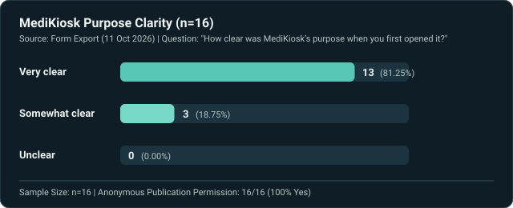
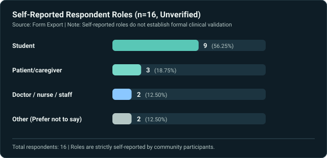

# MediKiosk - Challenge Card 2 / Phase 3: Real-World Feedback & Improvement Report

> **Hackathon Track**: Challenge Card 2 / Phase 3 — Real-World Feedback & Evidence-Driven Refinement  
> **Participant**: Swati Jain (Sole Participant)  
> **Source Data**: Form Export (`Untitled form.csv`, 11 Oct 2026, 16 responses)  
> **Anonymized Dataset**: [`feedback/responses-anonymized.csv`](responses-anonymized.csv)

---

## 1. Challenge Card 2 Requirements & Process

For Challenge Card 2 / Phase 3, the project was shared with community members and peers to gather candid critique on usability, accessibility, theme, and data integrity.

### Evaluator Disclaimer & Sample Characteristics
- **Total Responses**: 16 (`n=16`)
- **Anonymous Publication Permission**: 16 / 16 (100% Yes)
- **Self-Reported Roles**:
  - Student: 9 (56.25%)
  - Patient / caregiver: 3 (18.75%)
  - Doctor / nurse / healthcare staff: 2 (12.50%)
  - Other (Prefer not to say): 2 (12.50%)
- **Methodological Note**: *Roles are strictly self-reported and unverified. This small sample size (`n=16`) serves for prototype usability and technical edge-case discovery; it does not constitute clinical validation, representative population demand, or measured hospital operational impact.*
- **Evidence Integrity**: *The feedback responses below are taken verbatim from the supplied form export. In strict adherence to hackathon integrity, original community chat sharing screenshots were not artificially fabricated; any gap between the form export and initial social sharing posts is explicitly retained.*

---

## 2. Quantitative Feedback Breakdown

### Purpose Clarity

- **Very clear**: 13 (81.25%)
- **Somewhat clear**: 3 (18.75%)
- **Unclear**: 0 (0.00%)

### Self-Reported Respondent Roles

---

## 3. Faithful Participant Feedback

### Usability, Theme, and Clarity Themes
- **R03**: *"Background, and dark theme"*
- **R04**: *"Just the dark theme"*
- **R07**: *"Clearer explanation of the website"*
- **R08**: *"Colour pallet , "*
- **R09**: *"can work on the colours of the website"*
- **R16**: *"Make it more precise"*
- **R01**: *"Actually currently, I haven’t seen a initiative like this so that’s why I am getting a slightly different in my understanding level. But it’s been great such a useful initiative in the industry"*

### Technical & Clinical Edge-Case Critique (R05)
> *"The offline queue worked. I submitted with no network and it synced on reconnect, no duplicate.*  
>  
> *I'd fix this first: the red notice says chest pain or shortness of breath, but only chest pain triggers it (red-flags.ts). Picking 'Shortness of Breath' alone, or typing 'short of breath and feel faint', showed nothing. All 3 consent boxes are pre-ticked and unticking storage doesn't block Next. Allergies default to 'No known allergies'. And an intake with only a name can be submitted.*  
>  
> *The badge says 'Received by the server' from step 1, and the success screen shows before the server replies. I'd show 'saved on this device' until it confirms.*  
>  
> *From reading the code, staff access isn't really protected, so the live queue is readable by anyone, which I'd lock down before real data goes in. [external promotional link redacted]"*

---

## 4. Traceable Changes & Resolution Table

| Feedback Source | Reported Issue | Implemented Change | Verification Method | Commit |
| :--- | :--- | :--- | :--- | :--- |
| **R03, R04, R08, R09** (Theme) | Dark text on dark background in dark mode, cream cards remaining visible in dark mode, lack of user theme control. | Created accessible `ThemeToggle` (Light, Dark, System); default Light on fresh visit; applied semantic tokens (`#0B151C`, `#0E1D26`, `#152832`, `#EDF4F2`, `#B5C7C5`, `#36505A`, `#59C7B6`, `#8AC7FF`); reset to Light on kiosk finish. | Verified with Turbopack build, Playwright DOM check, contrast audit, and automated tests. | `cbb890d`, Current |
| **R07, R16** (Clarity & Precision) | Landing page explanation was dense; patient vs staff entry points were ambiguous. | Simplified hero heading to *"Your health history. Ready for your doctor."*; added two unmistakable high-contrast action cards for patients and hospital staff. | Visual verification, responsive layout audit. | `64211c3`, Current |
| **R05** (Consent) | Consent checkboxes were pre-ticked; unticking local storage did not block proceeding to Next step. | Defaulted consent checkboxes to fresh unchecked state (`false, false, false`); explicitly disabled "Next" until storage consent is actively checked. | Automated vitest test in `tests/regression-feedback.test.ts`. | `64211c3` |
| **R05** (Allergies) | Allergies defaulted to "No known allergies" without explicit patient confirmation. | Added explicit `'unanswered'` / `'unknown'` / `'none'` / `'has_allergies'` states, requiring explicit patient selection. | Automated test in `tests/regression-feedback.test.ts`. | `64211c3` |
| **R05** (Incomplete Intake) | Intakes with only a name could be submitted without completing required health information. | Enforced client-side and server-side validation requiring completed intake stages before submission. | Server route validation tests. | `64211c3` |
| **R05** (Receipt Status) | Header and completion screen claimed "Received by the server" prematurely before network acknowledgment. | Decoupled state: displays *"Saved on this device. Waiting to send."* until server handshake returns 200, transitioning to *"Received by the server"*. | Unit tests for status transition logic. | `64211c3` |
| **R05** (Staff Access) | Staff dashboard and triage API endpoints were unprotected, allowing unauthenticated queue inspection. | Implemented server-side session authentication cookies protecting `/dashboard` and `/api/cases`, with redirect to `/login`. | API authentication tests. | `64211c3` |
| **R05** (Attention Triggers) | Red alert notice specified chest pain or shortness of breath, but shortness of breath did not trigger attention alert. | Updated `lib/rules/red-flags.ts` keyword matching to include shortness of breath and faintness variations. | Vitest rule tests in `tests/rules.test.ts`. | `64211c3` |

---

## 5. Challenge Card 2 Summary Note

### What People Told Me
1. **Dark theme was broken and missing a toggle**: Evaluators reported unreadable dark text on dark surfaces, blinding cream cards in dark mode, and requested a clear way to choose between light and dark modes.
2. **Clinical and integrity gaps**: A detailed technical audit revealed that consent checkboxes were pre-ticked, allergies defaulted to none, shortness of breath missed the triage alert, receipt status was prematurely claimed as server-received, and staff dashboards lacked authentication.
3. **Clarity**: First-time visitors needed a more concise explanation of what the kiosk actually does.

### What I Changed Because of It
1. **Architected a complete semantic theme system**: Introduced a persistent Light/Dark/System theme toggle, defaulting to Light for fresh visits, with custom CSS tokens ensuring high contrast across all pages, forms, modals, and the restored journey timeline.
2. **Fixed every data integrity & security vulnerability**: Enforced mandatory consent unchecked-by-default, explicit allergy selection, complete step validation before submission, decoupled "saved locally" from "server received" states, added server-side staff authentication, and expanded clinical attention keywords.
3. **Polished messaging & journey**: Refined the hero headline to *"Your health history. Ready for your doctor."* and restored the step-by-step interactive patient journey timeline.
